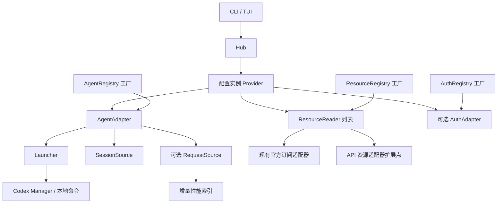

# Provider 架构与迁移边界

第一阶段的初始评估见 [全项目消融评估](provider-stage1-ablation.md)。其中四个失败契约已修复并纳入正式回归，当前行为与验证见 [优化记录](provider-stage1-optimization.md)。

第二阶段已接入资源连接配置、New API 和 OpenAI 费用查询及 CLI 消费者，详见 [资源连接](resource-connections.md)。首页的 Provider 目录与运行资源核对分开读取。

第三阶段已接入启动侧配置解析、运行资源关联快照与 `resources --run` 校验查询，详见 [运行资源关联](run-resource-binding.md)。原生 profile、项目配置层、OAuth 与会话恢复目前明确标记未解析。

第三阶段的测试覆盖与结构评估见 [运行资源关联消融](provider-stage3-ablation.md)。实验发现的嵌套命令门控缺口已修复，并补充常规回归、合并上下文读取、延迟构造资源服务，详见 [修复记录](provider-stage3-optimization.md)。

第四阶段已接入[首页中枢](home-overview.md)：默认展示 Provider 名称／类型／用量与余额／模型、官方状态列表、项目与会话快速恢复三个看板。Provider 目录独立于运行和账单查询，不在首页堆叠运行记录和启动信息。

第五阶段已接入[运行生命周期与会话关联](run-lifecycle.md)：内置 Agent 提供非阻塞运行句柄，托管 Codex 通过经过核验的生命周期 hooks 建立 Run 与 Session 的关系；首页独立更新会话活动状态。恢复会话的运行关联与 API 资源身份证明分开处理。

Usage 的 Provider 是一个配置实例，由 Agent、零个或多个资源服务及可选的认证能力组成。类型注册一次，账号作为工厂参数传入；同一 Provider 可以重复启动进程。

## 当前已经接入的路径

- `registry::FactoryRegistry<C, T>`：显式注入的有序工厂表，拒绝空 ID、重复注册，未知类型返回已注册列表。没有全局单例或动态插件加载。
- `agents::AgentRegistry`：登记 Codex、Claude、Grok。Agent 提供可选的 `Launcher` 和 `SessionSource`；自定义 Agent 可以声明自己的会话 ID 校验，不必使用 UUID。
- `resources::ResourceRegistry`：登记 ChatGPT、Claude、Grok 官方订阅读取器，以及 New API 令牌/账号和 OpenAI 费用读取器。`ResourceSnapshot` 声明权限范围，区分配额窗口、余额、带时间范围的费用、支出和原始额度；余额保留十进制文本和币种，原始额度不自动转换成美元。
- `auth::AuthRegistry`：登记认证服务工厂，首个后端为 `codex_oauth`，支持浏览器与设备码登录。方法 ID 由适配器提供，自定义后端可以注册自己的方法。`AuthSpec` 显式绑定数据目录及可选账号；工厂返回值必须与请求的服务和上下文一致。
- `hub::Hub`：通过 `ProviderDefinition` 创建配置实例，提供 `spawn`、`resources`、`sessions` 和可选 `authentication`。不支持的能力返回 `CapabilityError::Unsupported`；缺少凭据、凭据失效和网络失败由资源状态分别表达。新账号可直接用 `Hub::authentication` 创建认证适配器，无需预先构造 Provider 或启动 Agent。
- Codex CLI、账号 TUI、托管会话恢复经过 Hub 进入 Agent 启动适配器。`Provider::start` 返回 `RunningAgent`，原 `spawn` 保留等待行为。Manager 负责同步、密钥注入、OAuth 租约、Bark／事件注入和运行记录，句柄负责进程退出后的记录与回收。
- 首页通过 `provider_catalog::CatalogService` 只读发现托管账号和显式推理连接，并以固定推理凭据获取模型列表；用量与余额通过独立资源计划读取，配置关联无需 Run。跟随 CC Switch 的账号可读取其已启用的内置用量参数。结果按刷新代次、Provider 与资源身份路由。已移除没有消费者的旧 `OverviewService`；运行诊断与资源核对继续通过 Manager、`runs` 和 `resources --run` 提供。
- 原用量工厂通过资源适配器的 `legacy_usage` 能力继续支持现有 CLI、JSON、TUI 和主动重置；新余额服务只实现 `ResourceReader` 即可，不需要伪造百分比。
- 内置会话目录使用 Agent 注册表创建对应 Home 的读取器，并在 Session 上保留该 Agent；当前终端恢复委托其 Launcher。复制命令与 Ghostty 分屏使用 Launcher 显式提供的命令导出能力，不支持时返回错误。原 `SessionRegistry::register` 仍支持仅有 loader 的旧来源。
- `Provider::sessions()` 从实例的 AgentContext 解析 Home，并将 Provider ID 作为会话实例身份，调用方不能替换为其他账号目录。
- `Provider::resources()` 与 `ResourceService` 共用资源层的并发收集和查询时间限制；单个任务 panic 或超时返回带原绑定的失败快照，其他结果继续返回并保持配置顺序。
- 托管 BYOK / OAuth 启动可动态接入独立的[本地观测网关](gateway.md)，固定本次 Provider、凭据和上游，后台记录 HTTP/SSE 指标。OAuth 保留内置提供方与 CLI 原生认证；WebSocket 握手返回 426，后续使用 HTTP/SSE。网关记录与历史日志共享性能查询入口，按明确的会话及启动范围选择来源；旧版本 WS 透传记录保留 CLI 来源选择兼容。
- `AgentAdapter::request_source()` 声明性能日志格式工厂；`Provider::performance_binding()` 解析实例 Home 与版本，`Provider::performance()` 读取独立索引。首页 Provider 按 `v` 打开模型性能弹窗，按需后台增量采集并分页读取；独立推理连接可显式配置日志实例。绑定、估算口径和读取预算见[Provider 性能](performance.md)。

工厂构造不请求网络、读取密钥或启动进程。HTTP、时间、凭据解析器由上下文传入，API 服务使用 `ApiConnection`，凭据引用仅在查询时解析。

## 认证任务

CLI 和账号管理页通过同一个 `AuthAdapter` 创建 `AuthTask`，查询准备、等待、取消中、保存、成功、失败或已取消状态。任务拥有后台工作线程；取消采用协作检查，丢弃句柄只发出取消请求，不阻塞 UI。适配器必须在写入凭据前调用 `begin_save`，它与取消请求使用同一把锁：取消先到则拒绝写入，保存先到则取消返回 false，等待提交结果。

Codex 适配器继续委托官方 CLI 完成授权和令牌刷新，复用 Manager 的账号租约、身份核对和暂存目录。CLI 和 TUI 在原生终端展示官方授权提示，同时显示任务阶段；`Ctrl+C` 等待登录进程回收和暂存目录清理。交互进程保留前台终端组，非交互登录进程单独分组以便取消时回收子进程。版本探测仍使用现有 10 秒超时，取消在探测返回后检查。

认证请求不实现 Debug 或序列化，任务快照只包含操作 ID、阶段、账号标识及安全错误，不包含令牌、原生登录输出或授权链接。Codex 认证日志记录服务、登录方法和任务阶段，底层 OAuth 操作保留现有账号及步骤诊断。此阶段只内置 Codex OAuth；Claude、Grok 和其他认证协议需要另行实现适配器。文件导入仍走 Manager 的本地导入流程。

本轮新增 6 项 Rust 回归，覆盖认证工厂与账号绑定、自定义登录方法、取消与保存的竞争边界、丢弃任务和异常处理，以及真实子进程取消和 CLI／TUI 的 PTY 登录流程。隔离账号目录后共 304 项 Rust 测试通过，另有 4 项公共消融执行器测试和 35 个变体锚点检查通过；Clippy 全 target、格式和差异检查通过。登录测试使用模拟 CLI 与合成凭据，不访问真实 OAuth 服务。

## 身份与实例

| 身份 | 含义 | 示例 |
| --- | --- | --- |
| Agent 类型 | CLI 和会话格式 | `codex` |
| 资源服务类型 | 资源查询协议 | `chatgpt_subscription`、`new_api_token`、`new_api_account`、`openai_costs` |
| Provider ID | 用户配置的组合实例 | `work-codex` |
| ResourceBinding | 资源账号及其配置版本 | 账号 ID + revision |
| RunRecord ID | 一次具体的托管进程运行 | 每次启动生成独立 ID |
| SessionKey | Home 实例、Agent 类型、会话 ID | 同 ID 会话可以存在于不同 Home |

资源缓存键由服务类型、账号、配置版本计算。现有本地订阅查询尚无独立的账号配置，因此使用解析后的 Home 路径作为账号作用域；路径经过哈希后进入状态栏缓存键。不同 Home 的成功结果和网络错误回退不会互相复用。UI 刷新、主动重置与低额度提醒同样使用该资源作用域；工具 ID 只负责类型样式和共享服务状态。相同 Home 内切换登录仍沿用现有缓存 TTL，后续账号配置迁移应提供显式账号和 revision。

`usage codex runs [账号] --json` 可以读取历史运行记录，包括启动时选中的账号、保存的配置版本、项目目录、PID 和退出结果。新运行额外保存 `RunContext`，包含启动侧解析身份和资源关联；新增 `run_contexts` 表，旧记录保持 context 为 null。没有结束时间只表示缺少结束记录，不能据此判断进程仍存活。

## 后续迁移

当前阶段完成注册表、能力接口和现有调用路径迁移。以下功能尚未实现，不能仅凭模型已经支持余额就视为已接入：

1. 将目前托管 Codex 的会话事件能力扩展到其他 Agent。`resources --run` 仍要求端点、凭据核对；会话事件不作为远端账号成员关系的证明。
2. 扩展更多服务协议与凭据引用来源。独立资源使用环境变量；首页也支持明确跟随 CC Switch 的已保存账号和对应查询参数，不猜测未知站点协议。
3. 将订阅卡片与旧 CLI 消费者迁入类型化资源展示后，再移除 `legacy_usage` 兼容能力。独立资源 CLI 已直接使用 `ResourceSnapshot`；首页在 Provider 下展示类型化资源与模型。
4. 通过 Agent 事件补全原生 profile、项目层、会话恢复及交互内切换等配置来源。当前支持保存的 BYOK 配置及模型／TOML 参数覆盖；未支持的来源拒绝推断关联，`RunRecord.revision` 始终记录保存版本。
5. 扩展跨客户端的实时事件及更完整的 Agent 活动状态。现有 `start` 句柄和托管事件已能确认运行与会话关系，但 Home 扫描本身仍不是某次 Run 的会话集合；缺失事件的旧实例不回填归属。
6. 将历史读取、数据目录发现、统一缓存调度等剩余职责迁入对应能力和应用服务。

扩展的集成测试使用自定义 Agent、非 UUID 会话和只提供余额的资源适配器，验证无需修改内置分派。真实子进程测试并行启动同一账号的两个配置版本，验证独立运行 ID 和版本记录。已有 Bark/OAuth 回归继续覆盖原启动保证。

## 结构收敛（2026-10-18）

移除首页迁移后没有消费者的旧 `overview` 模块及其专用测试。Provider 目录仍使用 `CatalogService`，运行记录与资源身份证明继续由 Manager 和 `runs` 处理。工厂、注册表、订阅兼容能力及来源／缓存隔离边界保持原职责。

模型目录与 API 资源共用 HTTP 层的地址校验，各自保留端点路径规则及错误文案。没有附带 Agent 的旧 Codex Session 在恢复时补建内置 Agent，之后统一调用 Launcher；Home、账号版本、Bark 和自定义启动适配器仍由启动器处理。CLI 的 `run` 在打开 Manager 前分派，避免提前创建或重复初始化账号库；启动和退出记录保留各自所需的存储操作。

首页移除遗留的额度样式状态、1/2/3/s 快捷键、保存函数和无用途的绘制转发。`style` 配置与 `--once --style` 文本输出继续可用。

本轮验证：隔离账号目录后，298 项 Rust 回归通过（移除旧模块的 6 项专用测试，新增 2 项启动／分屏回归）；Clippy 全 target、格式和差异检查通过。公共消融执行器的 4 项 Python 测试覆盖环境隔离、嵌套测试计数、无效实验拒绝、日志保留及恢复输入核验。两份脚本的全部 35 个变体锚点通过；实际执行确认提前打开 Manager 会触发 2 项回归、取消事务会触发孤立运行记录回归，重复上下文读取对照仍通过。历史 JSON 报告保留原始结果。
