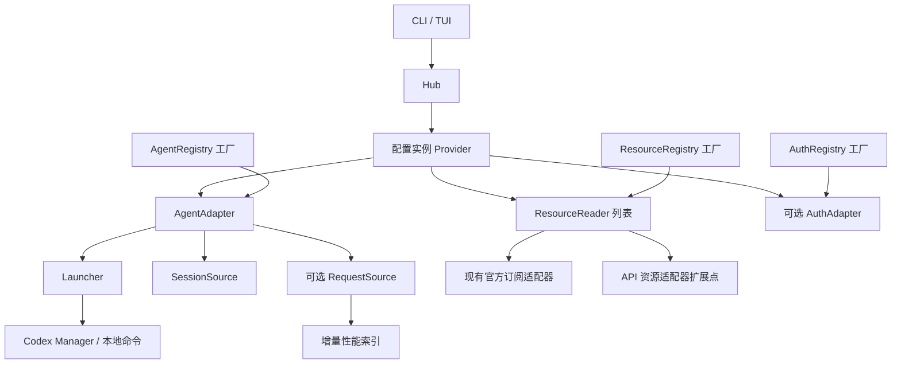

# Provider 架构与迁移边界

第一阶段的初始评估见 [全项目消融评估](provider-stage1-ablation.md)。其中四个失败契约已修复并纳入正式回归，当前行为与验证见 [优化记录](provider-stage1-optimization.md)。

第二阶段已接入资源连接配置、New API 和 OpenAI 费用查询及 CLI 消费者，详见 [资源连接](resource-connections.md)。首页的 Provider 目录与运行资源核对分开读取。

第三阶段已接入启动侧配置解析、运行资源关联快照与 `resources --run` 校验查询，详见 [运行资源关联](run-resource-binding.md)。原生 profile、项目配置层、OAuth 与会话恢复目前明确标记未解析。

第三阶段的测试覆盖与结构评估见 [运行资源关联消融](provider-stage3-ablation.md)。实验发现的嵌套命令门控缺口已修复，并补充常规回归、合并上下文读取、延迟构造资源服务，详见 [修复记录](provider-stage3-optimization.md)。

第四阶段已接入[首页中枢](home-overview.md)：默认展示 Provider 名称／类型／用量与余额／模型、官方状态列表、项目与会话快速恢复三个看板。Provider 目录独立于运行和账单查询，不在首页堆叠运行记录和启动信息。

第五阶段已接入[运行生命周期与会话关联](run-lifecycle.md)：内置 Agent 提供非阻塞运行句柄，托管 Codex 通过经过核验的生命周期 hooks 建立 Run 与 Session 的关系；首页独立更新会话活动状态。恢复会话的运行关联与 API 资源身份证明分开处理。

Usage 的 Provider 是一个配置实例，由 Agent、零个或多个资源服务及可选的认证能力组成。类型注册一次，账号作为工厂参数传入；同一 Provider 可以重复启动进程。

## 当前已经接入的路径

- `registry::FactoryRegistry<C, T>`：显式注入的有序工厂表，拒绝空 ID、重复注册，未知类型返回已注册列表。没有全局单例或动态插件加载。
- `agents::AgentRegistry`：登记 Codex、Claude、Grok。Agent 提供可选的 `Launcher` 和 `SessionSource`；自定义 Agent 可以声明自己的会话 ID 校验，不必使用 UUID。
- `resources::ResourceRegistry`：登记 ChatGPT、Claude、Grok 官方订阅读取器，以及 New API 令牌/账号和 OpenAI 费用读取器。`ResourceSnapshot` 声明权限范围，区分配额窗口、余额、带时间范围的费用、支出和原始额度；余额保留十进制文本和币种，原始额度不自动转换成美元。
- `auth::AuthRegistry`：登记认证服务工厂，首个后端为 `codex_oauth`，支持浏览器与设备码登录。方法 ID 由适配器提供，自定义后端可以注册自己的方法。`AuthSpec` 显式绑定数据目录及可选账号；工厂返回值必须与请求的服务和上下文一致。
- `hub::Hub`：通过 `ProviderDefinition` 创建配置实例，提供 `spawn`、`resources`、`sessions` 和可选 `authentication`。不支持的能力返回 `CapabilityError::Unsupported`；缺少凭据、凭据失效和网络失败由资源状态分别表达。新账号可直接用 `Hub::authentication` 创建认证适配器，无需预先构造 Provider 或启动 Agent。
- Codex CLI、账号 TUI、托管会话恢复经过 Hub 进入 Agent 启动适配器。`Provider::start` 返回 `RunningAgent`，原 `spawn` 保留等待行为。Manager 负责同步、密钥注入、OAuth 租约、Bark／事件注入和运行记录，句柄负责进程退出后的记录与回收。
- 首页通过 `provider_catalog::CatalogService` 只读发现托管账号和显式推理连接，并以固定推理凭据获取模型列表；用量与余额通过独立资源计划读取，配置关联无需 Run。跟随 CC Switch 的账号可读取其已启用的内置用量参数。结果按刷新代次、Provider 与资源身份路由。已移除没有消费者的旧 `OverviewService`；运行诊断与资源核对继续通过 Manager、`runs` 和 `resources --run` 提供。
- 原用量工厂通过资源适配器的 `legacy_usage` 能力继续支持现有 CLI、JSON、TUI 和主动重置；新余额服务只实现 `ResourceReader` 即可，不需要伪造百分比。
- 内置会话目录使用 Agent 注册表创建对应 Home 的读取器，并在 Session 上保留该 Agent；当前终端恢复委托其 Launcher。复制命令与 Ghostty 分屏使用 Launcher 显式提供的命令导出能力，不支持时返回错误。原 `SessionRegistry::register` 仍支持仅有 loader 的旧来源。
- `Provider::sessions()` 从实例的 AgentContext 解析 Home，并将 Provider ID 作为会话实例身份，调用方不能替换为其他账号目录。
- `Provider::resources()` 与 `ResourceService` 共用资源层的并发收集和查询时间限制；单个任务 panic 或超时返回带原绑定的失败快照，其他结果继续返回并保持配置顺序。
- 托管 BYOK 启动可动态接入独立的[本地观测网关](gateway.md)，固定本次 Provider、凭据和上游，后台记录 HTTP/SSE 指标。官方订阅（OAuth）始终直连，性能来自会话日志；默认 WebSocket 握手返回 426，后续使用 HTTP/SSE；单次启动可选择 WS，复用相同的指标计算和存储。网关记录与历史日志共享性能查询入口，按明确的会话及启动范围选择来源；仅旧版透传或无法可靠观测的 WS 启动回退 CLI 来源，避免重复计数。
- `AgentAdapter::request_source()` 声明性能日志格式工厂；`Provider::performance_binding()` 解析实例 Home 与版本，`Provider::performance()` 读取独立索引。首页 Provider 按 `v` 打开模型性能弹窗，按需后台增量采集并分页读取；独立推理连接可显式配置日志实例。绑定、估算口径和读取预算见[Provider 性能](performance.md)。

工厂构造不请求网络、读取密钥或启动进程。HTTP、时间、凭据解析器由上下文传入，API 服务使用 `ApiConnection`，凭据引用仅在查询时解析。

## 认证任务

CLI 和账号管理页通过同一个 `AuthAdapter` 创建 `AuthTask`，查询准备、等待、取消中、保存、成功、失败或已取消状态。任务拥有后台工作线程；取消采用协作检查，丢弃句柄只发出取消请求，不阻塞 UI。适配器必须在写入凭据前调用 `begin_save`，它与取消请求使用同一把锁：取消先到则拒绝写入，保存先到则取消返回 false，等待提交结果。

Codex 适配器继续委托官方 CLI 完成授权和令牌刷新，复用 Manager 的账号租约、身份核对和暂存目录。CLI 和 TUI 在原生终端展示官方授权提示，同时显示任务阶段；`Ctrl+C` 等待登录进程回收和暂存目录清理。交互进程保留前台终端组，非交互登录进程单独分组以便取消时回收子进程。版本探测仍使用现有 10 秒超时，取消在探测返回后检查。

认证请求不实现 Debug 或序列化，任务快照只包含操作 ID、阶段、账号标识及安全错误，不包含令牌、原生登录输出或授权链接。Codex 认证日志记录服务、登录方法和任务阶段，底层 OAuth 操作保留现有账号及步骤诊断。此阶段只内置 Codex OAuth；Claude、Grok 和其他认证协议需要另行实现适配器。文件导入仍走 Manager 的本地导入流程。

本轮新增 6 项 Rust 回归，覆盖认证工厂与账号绑定、自定义登录方法、取消与保存的竞争边界、丢弃任务和异常处理，以及真实子进程取消和 CLI／TUI 的 PTY 登录流程。隔离账号目录后共 304 项 Rust 测试通过，另有 4 项公共消融执行器测试和 35 个变体锚点检查通过；Clippy 全 target、格式和差异检查通过。登录测试使用模拟 CLI 与合成凭据，不访问真实 OAuth 服务。

## 身份与实例

| 身份 | 含义 | 示例 |
| --- | --- | --- |
| Agent 类型 | CLI 和会话格式 | `codex` |
| 资源服务类型 | 资源查询协议 | `chatgpt_subscription`、`new_api_token`、`new_api_account`、`openai_costs` |
| Provider ID | 用户配置的组合实例 | `work-codex` |
| ResourceBinding | 资源账号及其配置版本 | 账号 ID + revision |
| RunRecord ID | 一次具体的托管进程运行 | 每次启动生成独立 ID |
| SessionKey | Home 实例、Agent 类型、会话 ID | 同 ID 会话可以存在于不同 Home |

资源缓存键由服务类型、账号、配置版本计算。现有本地订阅查询尚无独立的账号配置，因此使用解析后的 Home 路径作为账号作用域；路径经过哈希后进入状态栏缓存键。不同 Home 的成功结果和网络错误回退不会互相复用。UI 刷新、主动重置与低额度提醒同样使用该资源作用域；工具 ID 只负责类型样式和共享服务状态。相同 Home 内切换登录仍沿用现有缓存 TTL，后续账号配置迁移应提供显式账号和 revision。

`usage codex runs [账号] --json` 可以读取历史运行记录，包括启动时选中的账号、保存的配置版本、项目目录、PID 和退出结果。新运行额外保存 `RunContext`，包含启动侧解析身份和资源关联；新增 `run_contexts` 表，旧记录保持 context 为 null。没有结束时间只表示缺少结束记录，不能据此判断进程仍存活。

## 后续迁移

当前阶段完成注册表、能力接口和现有调用路径迁移。以下功能尚未实现，不能仅凭模型已经支持余额就视为已接入：

1. 将目前托管 Codex 的会话事件能力扩展到其他 Agent。`resources --run` 仍要求端点、凭据核对；会话事件不作为远端账号成员关系的证明。
2. 扩展更多服务协议与凭据引用来源。独立资源使用环境变量；首页也支持明确跟随 CC Switch 的已保存账号和对应查询参数，不猜测未知站点协议。
3. 将订阅卡片与旧 CLI 消费者迁入类型化资源展示后，再移除 `legacy_usage` 兼容能力。独立资源 CLI 已直接使用 `ResourceSnapshot`；首页在 Provider 下展示类型化资源与模型。
4. 通过 Agent 事件补全原生 profile、项目层、会话恢复及交互内切换等配置来源。当前支持保存的 BYOK 配置及模型／TOML 参数覆盖；未支持的来源拒绝推断关联，`RunRecord.revision` 始终记录保存版本。
5. 扩展跨客户端的实时事件及更完整的 Agent 活动状态。现有 `start` 句柄和托管事件已能确认运行与会话关系，但 Home 扫描本身仍不是某次 Run 的会话集合；缺失事件的旧实例不回填归属。
6. 将历史读取、数据目录发现、统一缓存调度等剩余职责迁入对应能力和应用服务。

扩展的集成测试使用自定义 Agent、非 UUID 会话和只提供余额的资源适配器，验证无需修改内置分派。真实子进程测试并行启动同一账号的两个配置版本，验证独立运行 ID 和版本记录。已有 Bark/OAuth 回归继续覆盖原启动保证。

## 结构收敛（2026-10-18）

移除首页迁移后没有消费者的旧 `overview` 模块及其专用测试。Provider 目录仍使用 `CatalogService`，运行记录与资源身份证明继续由 Manager 和 `runs` 处理。工厂、注册表、订阅兼容能力及来源／缓存隔离边界保持原职责。

模型目录与 API 资源共用 HTTP 层的地址校验，各自保留端点路径规则及错误文案。没有附带 Agent 的旧 Codex Session 在恢复时补建内置 Agent，之后统一调用 Launcher；Home、账号版本、Bark 和自定义启动适配器仍由启动器处理。CLI 的 `run` 在打开 Manager 前分派，避免提前创建或重复初始化账号库；启动和退出记录保留各自所需的存储操作。

首页移除遗留的额度样式状态、1/2/3/s 快捷键、保存函数和无用途的绘制转发。`style` 配置与 `--once --style` 文本输出继续可用。

本轮验证：隔离账号目录后，298 项 Rust 回归通过（移除旧模块的 6 项专用测试，新增 2 项启动／分屏回归）；Clippy 全 target、格式和差异检查通过。公共消融执行器的 4 项 Python 测试覆盖环境隔离、嵌套测试计数、无效实验拒绝、日志保留及恢复输入核验。两份脚本的全部 35 个变体锚点通过；实际执行确认提前打开 Manager 会触发 2 项回归、取消事务会触发孤立运行记录回归，重复上下文读取对照仍通过。历史 JSON 报告保留原始结果。

## 官方订阅指纹测试

[模型指纹测试](fingerprint.md) 是独立的主动检测能力，不属于用量读取或用户 Agent 会话。CLI、应用内调度和首页通过同一个 `FingerprintService` 使用账号绑定、执行策略与报告存储；官方订阅适配器复用 Manager 的 OAuth 租约和身份校验，固定 gpt-6.1-sol，不注入交互会话 hooks。当前只有一种检测后端，使用具体适配器，未新增注册表。

交互应用入口统一持有后台任务，最多并发两个账号；配置、采样及历史记录按账号隔离失败。首页的只读快照通过现有 AppEvent 和代次校验更新，历史缓存仅在报告或运行目录变更后重建。测试状态与官方服务健康状态分别建模。退出应用通过共享取消标记停止并回收采样进程，原始报告与启用配置继续保留，不安装系统任务。

## Provider 插件宿主

[Provider 插件](plugins.md) 由现有网关持有独立 Bun/Node 宿主。插件包、上游 Backend、账号和带 Agent 的 Provider 实例分开标识；WorkBuddy 与 WorkBuddy AI 来自同一插件的两个导出工厂；Trae CN 与 Trae Global 同样通过独立导出工厂接入。通用兼容层执行 OpenCode Provider v1 及用量/刷新扩展，不在 Rust 分派服务商接口。

认证桥接根据能力快照注册 `AuthRegistry` 工厂；插件方法采用动态文本并复用 `AuthTask` 的保存边界。资源桥接使用 `ResourceRegistry` 的 `plugin_account` 工厂，首页模型查询独立执行并按包版本、配置 revision 和账号缓存。`RouteAuth::Plugin` 引用插件账号，Agent 只获得本次路由的能力令牌。Rust credential broker 统一保存 opaque auth，按账号串行刷新并用 generation 拒绝过期写入。

原生 HTTP 转发和插件 fetch 共用运行租约、观测及索引。Responses 到 Chat 的转换独立于服务商插件；不支持的协议或工具明确失败。明确绑定的插件恢复通过临时 CLI 配置固定传输，原资源身份仍保持未解析。构造工厂不加载 JS、不读凭据或请求网络；能力发现和插件调用发生在后台服务边界。

## 统一 Provider 管理

F4 的 Provider 管理承接已有账号的操作；首页和管理页的 `a`、F5 共用 `ui::provider_setup` 添加弹窗，功能菜单不单列添加页。BYOK、OAuth 和文件/CC Switch 导入位于 `provider_setup::native`，服务商插件复用统一认证接口，管理 UI 不参与接入流程的状态机。

界面合并不改变凭据和 Agent 配置的数据边界：插件账号继续存入插件账号库，Codex 配置保留模型、推理强度与账号引用。编辑插件绑定只显示名称、模型和推理强度，保留共享账号及其推理凭据。OAuth 提供原地重新登录；当前插件认证仅创建独立账号，其管理项不显示原地重新登录操作。

Provider 操作的确认转换由 `ui::confirmation` 统一管理，重置和签到保留各自业务报告与异步结果生命周期。内置插件动作由 `plugins::capabilities` 投影到账号操作工厂，Rust/JS 共用能力清单，Catalog 只装配操作，不判断具体服务商的签到规则。

Agent 配置表单的模型与推理强度使用选项列表，可筛选，也可输入自定义值。模型选项来自 `CatalogService::models`：已保存的 Provider 与首页共用同一套查询构造（托管账号经 Manager，插件账号经同一插件查询），只读取当前 Provider 的凭据；新 BYOK 按表单中的端点和密钥查询。推理强度的取值属于 Codex 配置语义，由 `codex_manager::config::REASONING_EFFORTS` 提供，UI 只负责展示文案。

管理页启动前先选择项目目录。项目由 `projects` 模块管理：`projects.sqlite3` 只保存用户意图（手动添加、置顶、移出与从 Usage 启动的时间），会话派生的目录在读取时由 `projects::catalog` 合并，不写入项目库；项目库不参与 Run 归属。首页项目看板、管理页的项目选择与 `usage projects` 共用这一合并规则，会话目录通过调用方注入的 `SessionRegistry` 与 `SessionHomes` 读取；`SessionHomes::from_config` 统一解析默认目录与数据实例。启动终端只承载 Agent 输出：启动前的 CC Switch 同步结果写入日志，由管理页和 `usage codex sync` 展示。网关以 `-c model_providers.<id>.base_url` 注入，参数名的构造规则在 `launcher::provider_override` 中维护；Codex 不解析带引号的 TOML 键，无法以裸键引用的 provider ID 直接启动失败，不回退为不经观测的直连。

## 解耦（2026-10-24）

- **组合根**：`hub::Hub` 是唯一决定有哪些 Agent、资源服务与认证后端的位置。注册表只构建一次并以 `Arc` 共享，`hub::shared()` 返回进程内的 Hub；嵌入方在首次使用前调用 `hub::install` 注入自定义工厂。资源服务、模型目录、会话目录、认证入口与托管启动都从 Hub 取注册表，不再各自调用 `builtin_registry()`。插件资源与认证工厂在组合时注册，`resources` 与 `plugins` 之间不再互相构建注册表。
- **托管实例**：`AgentContext` 为 `Local { home }` 或 `Managed(Arc<dyn ManagedInstance>)`。账号库通过 `ManagedInstance`（Agent 类型、Home、性能绑定、启动、导出恢复命令）接入，`agents` 与 `hub` 不再引用 `codex_manager`。Codex 对本地 Home 的特殊处理（识别托管目录、注入通知）以 `LocalHooks` 在组合时提供；`RunRecord` 移至 `runs`。其他 Agent 接入托管多开只需实现 `ManagedInstance`。
- **首页目录**：`CatalogService::load` 按托管账号、插件账号、资源连接三个来源依次收集（`provider_catalog/sources.rs`），来源间的绑定关系以参数显式传递。插件库读取失败与单个签到操作创建失败会记录日志，不再静默隐藏或让整个目录失败。
- **托管启动**：`start_recorded_with_config` 拆为选择账号、准备命令、解析配置并接入观测、注入 hooks、启动并记录五个阶段（`codex_manager/launch.rs`），日志步骤名称不变；运行记录读写位于 `codex_manager/run_store.rs`。

## 稳定性与负载边界（2026-10-24）

- 插件账号锁和动作锁仅在定位单个账号的锁时持有全局映射锁，等待账号锁前释放映射锁。同账号保持串行，不同账号不会因其中一个账号排队而一起阻塞。
- OAuth 保存先验证并准备 Home，再替换登录、提交账号事务。返回错误时恢复原认证、配置及绑定文件；恢复失败会保留私有备份目录并返回位置。提交成功后不再执行会让调用者误判保存失败的查询或物化。该阶段的补偿最初仅覆盖可返回的错误；后续加入的持久恢复协议见下文。
- 资源查询同时最多执行 8 项，排队后的超时从实际开始查询计时；整体取消会撤销正在执行的任务。模型查询失败在下一轮刷新时重试，成功缓存仍按原身份复用。元数据 HTTP 响应按块读取并限制为 4 MiB，推理流继续由网关流式转发。
- 历史、会话和性能读取共用 `logfiles` 的普通／压缩日志身份与读取入口。历史账本先提供缓存，再发现和解析日志；解析和 JSON 序列化不持有 SQLite 写事务，每个文件用条件更新避免旧刷新覆盖并发写入。后续已将账本拆为游标和记录表，具体边界见下文。
- 托管恢复命令携带实例自己的账号库路径；已删除项目的相对路径仍归一到原项目身份。损坏的 Bark 配置会停用本次通知并显示原因，Agent 启动继续执行。
- 捕获输出的后台探测拥有独立进程组，取消或超时回收组内子进程；前台 Agent 的终止先通知所持有的子进程，给包装器转发与回收机会，再强制终止。前台路径不声称拥有任意后代进程树。

日常 push 与 PR 的 CI 执行 Rust 格式检查、Clippy 全 target、串行 Rust 回归、插件 JavaScript 回归及 Python 执行器测试。测试使用临时账号目录与本地模拟服务。

## 后台流程与界面分离（2026-10-24）

`CatalogService::refresh` 统一负责读取配置、构建目录、按身份复用缓存，以及并行查询模型和资源。它先发布目录，再发布带目标身份的结果，最后发送完成事件；一个资源读取器异常不会阻止其他查询或让加载状态永久停留。接收方关闭或刷新 future 被丢弃时取消异步查询，已经开始的本地发现可以在后台收尾。UI 仅附加刷新代次、接收事件并更新选择与展示；旧代次的完成事件同样不能清除新任务。

`performance::Service::start_load` 接受固定的绑定、时间窗口、模型及页码，先读取索引，再按原预算采集和发布进度。返回的 `LoadTask` 同时拥有异步协调任务和磁盘批次的取消标记，丢弃句柄会中止协调器并通知正在执行的批次。接收方返回 false 时停止后续采集；数据库错误或解析器 panic 会发布结束加载的错误。单次文件系统操作、正在执行的解析器调用和 SQLite 提交仍属于协作取消边界，不能承诺立即打断。

Dashboard 保留交互状态、事件代次和选择逻辑；绘制位于 `ui/app/render.rs`，六组原有回归测试按原模块名移入 `ui/app/`，测试筛选名称不变。性能弹窗只持有 `LoadTask`，不再自行组合 `JoinHandle` 与 `AtomicBool`。历史账本、会话与通知的任务所有权由下述统一后台任务机制接管。

新增回归覆盖缓存先行、查询独立完成、接收方关闭、解析异常、任务首次执行前和磁盘批次执行中的取消，以及完成事件代次隔离。消融脚本同步新的托管启动与运行记录位置，CI 增加全部变体锚点校验；锚点及编译检查不等同于重新执行完整消融实验。

## 历史存储、任务取消与 OAuth 恢复（2026-10-24）

`history::ledger` 管理历史账本，将文件解析游标与用量记录分开保存。`history_files` 的 JSON 只保留文件边界摘要和解析状态，`history_records` 按记录存储；增量刷新只插入新记录。游标的比较交换、记录插入以及文件重写时的记录替换在同一 SQLite 事务内完成，失败时一并回滚。旧账本按文件事务迁移，原日志已删除时仍可恢复统计；旧原始指纹被摘要替换后清理空闲页。此格式向前迁移，旧版本程序不能直接读取拆分后的完整统计。

读取按行解码和聚合，缓存只保留文件游标。Dashboard 与历史面板通过 `Arc<History>` 共享结果，避免界面额外复制整份记录。内存仍随最终去重记录数增长，解析首次导入或重写的单个大文件时也需要保存该文件的新记录；这一步尚未变成数据库分页查询或固定内存上限。万条记录回归验证游标大小、追加字节量，以及追加过程中不更新或删除旧记录；故障注入验证记录写入失败不会提前推进游标。

`background::Task` 统一拥有异步协调任务和协作取消令牌，丢弃即取消；`Task::blocking` 将阻塞读取 panic 转为安全错误，并停止向已取消的接收方发送结果。历史、会话、性能、指纹、运行状态、服务状态、额度查询、重置预览和通知已接入。内置会话读取器在目录、索引和长日志循环中检查令牌；自定义 Agent 可实现 `load_sessions`，旧 `SessionSource` 读取器保留兼容性，其单次调用仍只能等待返回。通知取消会终止并回收通知子进程，已经显示的通知不能撤回。单次文件读取、SQLite 操作和历史文件提交仍是协作取消边界。已确认的启动、剪贴板写入和额度消费保持执行语义，不因关闭来源视图被取消。

`codex_manager::oauth::recovery` 管理 OAuth 的文件恢复日志。保存先建立私有恢复目录，持久化旧文件副本及带摘要的清单，再替换账号文件；同一数据库事务写入提交标记，并使用 SQLite `synchronous=FULL`。文件写入同步文件及父目录，恢复目录和新增账号目录在覆盖旧文件前同步。重启恢复和账号读写租约都会检查日志：未提交则复制备份恢复，已提交则保留新文件。恢复不消耗备份，因此恢复途中再次中断仍能重试；副本全部验证通过后才开始恢复，损坏时保留现场并拒绝使用该登录。清理先重命名日志目录并同步，再删除备份和提交标记，避免半删除日志被当作有效恢复记录。

子进程故障注入覆盖日志完成、文件替换、数据库提交和恢复过程中的无析构退出，以及新账号与已有账号。它验证进程崩溃恢复和同步顺序下的一致性，不等同于物理断电试验，也不能覆盖存储硬件不遵守同步语义的情况。

子进程输出读取在 Unix 上通过管道就绪事件等待数据，避免每个数据块固定休眠导致大输出超时；原有超时、进程组回收和 4 MiB 输出上限保持不变。

## 查询成本与故障隔离（2026-10-24，后续阶段）

历史筛选报表直接聚合日期和账号桶，不再为了报表复制全部匹配记录。日期范围只有一端时，账号汇总与日历总计统一使用所选年份补齐的另一端。面板最多缓存 8 份报表，键包含历史快照身份、来源、年份、有效日期筛选和时区；同年日期移动与重复重绘复用结果，换快照或筛选后重新计算。缓存对旧历史使用弱引用，不延长旧账本生命周期。这降低重绘开销，但仍不是数据库分页；最终历史快照及首次筛选成本依旧随记录数增长。

签到预览、自动签到状态、添加 Provider 的只读等待和模型列表也使用统一任务所有权。异步读取 panic 返回安全的结束结果；关闭或替换查询会取消旧任务。模型列表在端点或密钥编辑后失效，避免展示其他绑定的缓存。确认后的签到执行独立完成，即使面板被销毁也不取消已经提交的操作；panic/超时只报告结果未确认，不自动重复提交。

OAuth 启动恢复按账号隔离：损坏的单个恢复日志不会阻止 Manager 和其他账号打开，受影响账号的认证读取、物化和保存仍在租约处拒绝执行。诊断记录恢复操作、账号 ID、提交判断、备份校验、恢复及清理阶段，不记录凭据、配置内容或邮箱。成功提交后的清理失败记录为待重试，不将已完成的保存误报为失败。

## 历史查询、并发预算与界面状态（2026-10-25）

生产历史加载返回轻量快照：文件游标和来源范围保留在内存，完整记录继续存于 SQLite。`history::query` 在数据库中按配置实例范围去重，执行日期、来源、项目、模型和实例筛选，再按日、实例或会话聚合；历史面板的筛选选项使用数据库 DISTINCT。CLI 与 Dashboard 使用这个入口，报表不再要求先构建整份 `History.records`。用于兼容和对照的 `HistoryCache::load` 仍会物化记录；显式调用 `filtered` 时也会物化该次结果。查询目前会扫描所选范围的账本行并建立临时去重结果，降低 Rust 堆占用，但大账本的查询耗时仍需进一步基准测量和索引优化。

`history::sources` 的读取器接口与静态注册表拥有各来源的目录、文件名、初始状态、行预筛和解析逻辑。通用加载器只处理游标、文件变更、账本事务和取消。新增历史来源需要注册读取器，不再在通用循环中增加对应的解析分支。

`background` 为只读查询和阻塞读取分别设置共享执行槽与有界等待队列。等待执行槽的时间不计入请求超时；取消等待者释放队列位置，已开始的阻塞工作持有执行槽直到实际结束。Provider、模型、资源、服务状态及本地读取从同一入口获取预算；提交型写操作保留自身完成语义。

Dashboard 将历史、会话、首页活动、概览、服务状态和诊断任务归入各自状态结构，结构负责加载、取消、结束与代次更新。主循环仍负责事件分派与界面交互，但平铺字段和跨功能状态修改减少。
