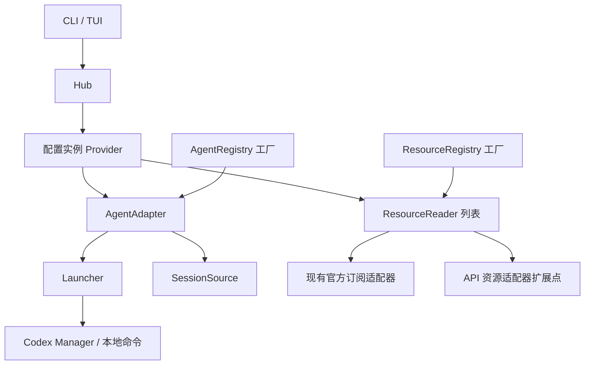

# Provider 架构与迁移边界

第一阶段的初始评估见 [全项目消融评估](provider-stage1-ablation.md)。其中四个失败契约已修复并纳入正式回归，当前行为与验证见 [优化记录](provider-stage1-optimization.md)。

Usage 的 Provider 是一个配置实例，由 Agent 和零个或多个资源服务组成。类型注册一次，账号作为工厂参数传入；同一 Provider 可以重复启动进程。

## 当前已经接入的路径

- `registry::FactoryRegistry<C, T>`：显式注入的有序工厂表，拒绝空 ID、重复注册，未知类型返回已注册列表。没有全局单例或动态插件加载。
- `agents::AgentRegistry`：登记 Codex、Claude、Grok。Agent 提供可选的 `Launcher` 和 `SessionSource`；自定义 Agent 可以声明自己的会话 ID 校验，不必使用 UUID。
- `resources::ResourceRegistry`：登记 ChatGPT、Claude、Grok 官方订阅读取器。`ResourceSnapshot` 区分配额窗口、余额、支出、原始额度；余额保留十进制文本和币种，原始额度不自动转换成美元。
- `hub::Hub`：通过 `ProviderDefinition` 创建配置实例，提供 `spawn`、`resources`、`sessions`。不支持的能力返回 `CapabilityError::Unsupported`；缺少凭据、凭据失效和网络失败由资源状态分别表达。
- Codex CLI、账号 TUI、托管会话恢复经过 Hub 进入 Agent 启动适配器。现有 Manager 继续负责同步、密钥注入、OAuth 租约、Bark 注入和运行记录，避免复制这些逻辑。
- 原用量工厂通过资源适配器的 `legacy_usage` 能力继续支持现有 CLI、JSON、TUI 和主动重置；新余额服务只实现 `ResourceReader` 即可，不需要伪造百分比。
- 内置会话目录使用 Agent 注册表创建对应 Home 的读取器，并在 Session 上保留该 Agent；当前终端恢复委托其 Launcher。复制命令与 Ghostty 分屏使用 Launcher 显式提供的命令导出能力，不支持时返回错误。原 `SessionRegistry::register` 仍支持仅有 loader 的旧来源。
- `Provider::sessions()` 从实例的 AgentContext 解析 Home，并将 Provider ID 作为会话实例身份，调用方不能替换为其他账号目录。
- `Provider::resources()` 在 Hub 层统一限制查询时间；单个任务 panic 或超时返回带原绑定的失败快照，其他结果继续返回并保持配置顺序。

工厂构造不请求网络、读取密钥或启动进程。HTTP、时间、凭据解析器由上下文传入，API 服务使用 `ApiConnection`，凭据引用仅在查询时解析。

## 身份与实例

| 身份 | 含义 | 示例 |
| --- | --- | --- |
| Agent 类型 | CLI 和会话格式 | `codex` |
| 资源服务类型 | 资源查询协议 | `chatgpt_subscription`，后续 `new_api` |
| Provider ID | 用户配置的组合实例 | `work-codex` |
| ResourceBinding | 资源账号及其配置版本 | 账号 ID + revision |
| RunRecord ID | 一次具体的托管进程运行 | 每次启动生成独立 ID |
| SessionKey | Home 实例、Agent 类型、会话 ID | 同 ID 会话可以存在于不同 Home |

资源缓存键由服务类型、账号、配置版本计算。现有本地订阅查询尚无独立的账号配置，因此使用解析后的 Home 路径作为账号作用域；路径经过哈希后进入状态栏缓存键。不同 Home 的成功结果和网络错误回退不会互相复用。UI 刷新、主动重置与低额度提醒同样使用该资源作用域；工具 ID 只负责类型样式和共享服务状态。相同 Home 内切换登录仍沿用现有缓存 TTL，后续账号配置迁移应提供显式账号和 revision。

`usage codex runs [账号] --json` 可以读取历史运行记录，包括启动时选中的账号、保存的配置版本、项目目录、PID 和退出结果。没有结束时间只表示缺少结束记录，不能据此判断进程仍存活。现有数据库结构没有改变。

## 后续迁移

当前阶段完成注册表、能力接口和现有调用路径迁移。以下功能尚未实现，不能仅凭模型已经支持余额就视为已接入：

1. 在账号配置中保存资源服务类型、独立查询端点、凭据引用及版本；当前配置文件和历史统计仍使用原有格式。
2. 实现 New API、官方 API 等实际资源适配器。普通推理密钥、账号凭据和管理密钥分别声明权限需求；不按兼容的推理端点猜测余额查询协议。
3. 将首页从原 `UsageSnapshot` 切换到 Provider/Run 和 `ResourceSnapshot`，再移除旧界面的兼容能力。现有额度首页不会自动展示 BYOK 余额。
4. 处理启动参数对模型、端点和凭据的覆盖，再将资源快照可靠地绑定到运行的实际配置。`RunRecord.revision` 当前记录选中的保存版本，不宣称已解析全部 CLI 覆盖。
5. 完善进程存活核对、非阻塞运行句柄和运行到会话的事件绑定。当前 `Launcher::spawn` 保持原有前台启动并等待退出的行为；多个调用可在不同线程或终端并行。会话扫描结果是 Home 的目录，不是某次 Run 的会话集合。
6. 将历史读取、数据目录发现、统一缓存调度等剩余职责迁入对应能力和应用服务。

扩展的集成测试使用自定义 Agent、非 UUID 会话和只提供余额的资源适配器，验证无需修改内置分派。真实子进程测试并行启动同一账号的两个配置版本，验证独立运行 ID 和版本记录。已有 Bark/OAuth 回归继续覆盖原启动保证。
